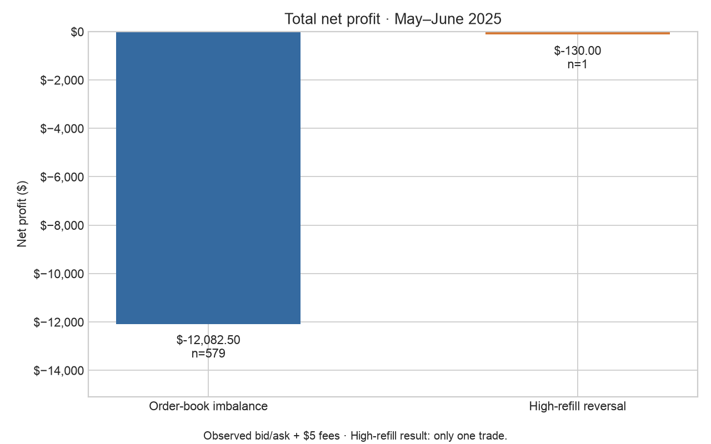
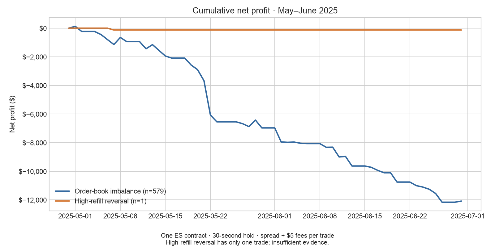

# FINM 37000: two simple trading strategies

After a 99.5th-percentile price shock, observe the order book for three seconds:

1. **Order-book imbalance:** buy when best-bid quantity is larger; sell when best-ask quantity is larger.
2. **High-refill reversal:** trade against the shock when the refill ratio is at least 0.5.

Each strategy trades one ES contract and holds for 30 seconds after entry.
Results include the observed bid/ask spread and $5 round-trip fees.

| May–June 2025 | Trades | Net profit |
|---|---:|---:|
| Order-book imbalance | 579 | **-$12,082.50** |
| High-refill reversal | 1 | **-$130.00** |

**The refill strategy has only one trade, so there is insufficient evidence to judge it.**





## Code and results

Use the self-contained **[simple_backtest folder](simple_backtest/)**:

```sh
cd simple_backtest
python -m pip install -r requirements.txt
python backtest.py
```

- [One short backtest script](simple_backtest/backtest.py)
- [Results, rules, assumptions, and shock graph](simple_backtest/README.md)
- [Profit table](simple_backtest/results.csv)
- [Individual trades](simple_backtest/trades.csv)

The small prepared data file is included; this run needs no API key or new download.
The rules use the existing team’s shock detector and refill measure. The latter
rarely records high refill because it tracks quantity at the old pre-shock price.

The earlier project work and raw-data preparation remain available.
[Original proposal, team information, and extended analysis](docs/extended_project.md).
