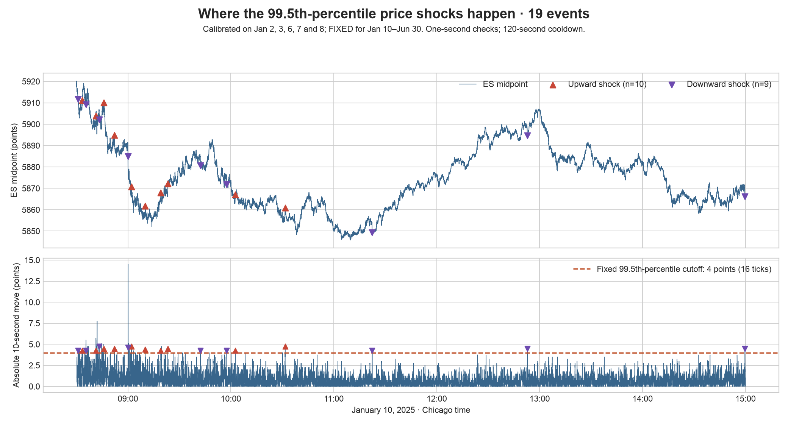

# Sweep or Snap Back? H1 continuation and H2 reversal



The triangles mark **38 shocks on January 10**. A shock is a 10-second midpoint
move **greater than 3.5 points (14 ticks)**. “99%” means the **99th percentile**
of historical move sizes, not a 99% return.

## Fixed threshold and timing

The 3.5-point cutoff is calculated **once**, using January 2, 3, 6, 7, and 8,
and stays fixed for the entire January 10–June 30 backtest. These five days are
calibration data only. A **session** means one trading day, 08:30–15:00 Chicago
time. **Three seconds** means the observation window after a shock; it does
not mean three sessions. There is no moving threshold in this version.

Check for shocks each second, with a 120-second cooldown. After a shock at `t0`,
observe through `t0 + 3 seconds`, enter at the first eligible quote at/after
`t0 + 3.1 seconds`, and exit 30 seconds after the actual entry.

## Refill ratio: one Mickey Mouse example

**Choose one price P immediately after the shock, at `t0`, and keep P fixed.**
Use the best ask for an up-shock and the best bid for a down-shock.

**RR = quantity at P three seconds later / quantity at P immediately after the shock.**

Both quantities refer to **the same price and the same side of the book**.
The denominator is measured at `t0`, not before the shock.

Imagine an upward price shock:

1. At `t0`, the best ask is **6004**, with **20 contracts**. Freeze P = 6004.
2. At `t0 + 3s`, the best ask is still **6004**, with **40 contracts**.
3. **RR = 40 / 20 = 2.0.** Depth at 6004 doubled. This is in the fast-refill group.

The available MBP-1 data shows only the best bid and ask. For the same example:

| Best ask three seconds later | Quantity used at fixed P = 6004 | RR |
|---|---|---|
| 6004, with 5 contracts | 5 | 5 / 20 = 0.25: passes H2 refill cutoff |
| 6004, with 40 contracts | 40 | 40 / 20 = 2.0: fast |
| 6004.25 | 0: no ask remains at 6004 | 0: slow |
| 6003.75 | Unknown: 6004 is behind the best ask | Missing: no trade |

For a down-shock, reverse the price comparisons and use bids: a best bid below
P means zero at P; a best bid above P hides P deeper in the book.
A smaller **quantity at the same price** gives a smaller ratio, not automatically zero.
Zero is used only when the quote has moved past P in the shock direction.

**H1 remains RR < 0.25. H2 now uses RR >= 0.25**, together with its reversing-flow condition.
At the same price, a denominator of 20 contracts means H1 requires fewer than
5 contracts after observation; H2 requires at least 5. RR exactly 0.25 belongs
to the H2 refill group. There is no middle RR exclusion with these selected cutoffs.

This is a deliberately relaxed H2 rule: at least 25% of the post-shock depth
remains. The label “fast refill” does **not** imply full depth recovery or new
orders. Unchanged depth gives RR = 1 and passes H2's refill condition, but H2
still needs reversing OFI. The ratio measures net displayed depth; trades and
cancellations can also change it.

**Skip an already recovered shock.** The pre-shock reference is the midpoint
at `t0 − 10s`. Check every valid quote update during the three-second observation:
for an up-shock, skip if midpoint reaches or falls below that reference;
for a down-shock, skip if midpoint reaches or rises above it. A recovery followed
by another move still causes a skip. A partial recovery alone does not.
For example, if midpoint rose from 6000 to 6004 and touches 6000 at +2 seconds,
there is no trade even if it is back at 6003 by +3 seconds.

## Two hypotheses and the 2 × 2 rule

Use quote **order-flow imbalance (OFI)** during `(t0, t0 + 3s]`, signed relative
to the shock. Positive supports continuation; negative supports reversal.
**Strong same-direction:** OFI > 0.05. **Reversing:** OFI < −0.05.
Values from −0.05 through +0.05 are neutral: no trade.

| | Strong same-direction flow | Reversing flow |
|---|---|---|
| **Slow refill: RR < 0.25** | **H1: follow** the shock | No trade |
| **H2 refill cutoff: RR >= 0.25** | No trade | **H2: fade** the shock |

H1 buys an up-shock and sells a down-shock. H2 does the opposite.
Unknown RR and already recovered shocks are excluded. Results apply to this
observable subset: MBP-1 often cannot measure the anchored price after the
market starts reversing. Changing cutoffs cannot recover those events.

## H2 threshold comparison; H1 unchanged

**H1 stays fixed at RR < 0.25.** Only H2 changes in this revision.
The previous H2 candidates (1.00 and 1.50) selected the same three January–April
trades. After inspecting the RR distribution, we compare **H2 >= 0.25**
(at least one-quarter of post-shock depth) with **H2 >= 1.00** (at least full depth).
These candidates were chosen after prior results and counts had been seen.

**Selection rule:** choose the higher total net profit, including spread and fees,
using **January 10–April 30 only**; if tied, use the higher, stricter H2 cutoff.
Freeze the selected cutoff for May–June. H1 is not retuned.

| Strategy | Candidate rule | January–April trades | January–April net profit | Choice |
|---|---|---:|---:|---|
| H2 | RR >= 0.25 | 7 | $902.50 | Selected |
| H2 | RR >= 1.00 | 3 | $235.00 |  |

**Selected H2 cutoff: RR >= 0.25.** It produces seven January–April trades,
versus three at 1.00, and $667.50 more net profit in that period. This relaxes
H2's depth requirement; it does not demonstrate that stronger refill predicts
better reversals. The sample is too small to establish an optimal threshold.

Only H2's RR cutoff and candidate list changed. H1, the fixed 99th-percentile
shock cutoff, same-price RR calculation, recovery filter, OFI cutoffs,
entry/exit timing, and costs stay fixed. May–June was examined in earlier
revisions, so it is **not a fresh untouched holdout**, even though this comparison
does not use it for threshold selection.

## Backtest results

One ES contract, $50 per point. Buy at observed ask and sell at observed bid;
subtract $5 round-trip fees. No additional slippage. At most one open position;
H1 and H2 use mutually exclusive signals.

| Period | Strategy | Trades | Net profit | Mean net/trade | Win rate | Max drawdown |
|---|---|---:|---:|---:|---:|---:|
| Jan 10–Jun 30 | H1 continuation | 934 | **−$9,132.50** | −$9.78 | 44.11% | $12,907.50 |
| Jan 10–Jun 30 | H2 reversal | 8 | **$847.50** | $105.94 | 37.50% | $290.00 |
| May–June | H1 continuation | 111 | **−$880.00** | −$7.93 | 41.44% | $1,787.50 |
| May–June | H2 reversal | 1 | **−$55.00** | −$55.00 | 0.00% | $55.00 |

January 10–April 30 alone: H1 had 823 trades and **−$8,252.50** net; H2 had 7 trades and **$902.50** net. The full-period rows include these development observations. The script also prints gross profit and total fees.


**Checking the predicted price direction (before costs):**

| Period | Hypothesis | Mean favorable move | 95% day-bootstrap interval | Active days |
|---|---|---:|---:|---:|
| Jan 10–Jun 30 | H1 continuation | 0.82 ticks | [-0.70, 2.42] ticks | 97 |
| Jan 10–Jun 30 | H2 reversal | 10.25 ticks | [-4.19, 29.06] ticks | 8 |
| May–June | H1 continuation | 0.83 ticks | [-1.02, 2.68] ticks | 35 |
| May–June | H2 reversal | -3.00 ticks | — | 1 |

A dash means there were no trades for a trade statistic, or fewer than two active days for a bootstrap interval.

**H1 continuation:** −$9,132.50 net over the full period (934 trades), and −$880.00 in May–June (111 trades). The May–June interval includes zero, so it does not establish a positive mean move in the predicted direction.

**H2 reversal:** $847.50 net over the full period (8 trades), and −$55.00 in May–June (1 trades). Only 1 May–June trade occurred; there are too few active days for the day-bootstrap interval. This cannot establish the hypothesis.

## Metrics and calculations

- **Net profit:** `side × (exit price − entry price) × $50 − $5` per trade;
  side is +1 for a buy and −1 for a sell. Execution prices already include spread.
- **Win rate:** percentage of trades with positive net profit.
- **Max drawdown:** largest peak-to-trough fall in cumulative realized net profit,
  starting from zero; it excludes unrealized intratrade losses.
- **Favorable price move:** midpoint change over the holding period in the trade’s
  predicted direction, divided by 0.25 to express ticks. Positive supports H1/H2.
- **95% interval:** 5,000 bootstrap resamples of entire active trading days,
  using seed 0. An interval spanning zero is inconclusive about mean direction.
  A positive mean move can still be unprofitable after spread and fees. These
  intervals describe the selected rules and do not adjust for threshold selection.

OFI uses the following quote changes for each update. Add the bid and ask
contributions to get `e`, then calculate
`OFI = shock_direction × sum(e) / sum(abs(e))`, or zero if the denominator is zero.

| Price change | Bid contribution | Ask contribution |
|---|---|---|
| Rises | Current bid quantity | Previous ask quantity |
| Unchanged | Current − previous bid quantity | Previous − current ask quantity |
| Falls | Negative previous bid quantity | Negative current ask quantity |

`shock_direction` is +1 for an up-shock, −1 for a down-shock. OFI is in [-1, 1].
A threshold of 0.05 requires net pressure greater than 5% of total absolute
quote-flow activity. This is not the static bid-versus-ask quantity ratio.

## Run and data

```sh
python -m pip install pandas numpy matplotlib
python backtest.py
```

`H1_RR_MAX` and `H2_RR_MIN` at the top of the script document the fixed selected
cutoffs. `H2_CANDIDATES` documents the two H2 alternatives; H1 stays fixed.

Five files, no subfolders: `backtest.py`, `events.csv`, `README.md`, `results.png`,
and the requested `shocks.png` illustration. The script reproduces the two-candidate H2 January–April comparison, recalculates
RR, OFI and the recovery filter, prints results, and updates
`results.png`. The shock illustration is included separately.

The CSV keeps `anchor_price` and `depth_at_shock` at t0, `best_price_after`
and `best_depth_after` at +3 seconds, and `pre_shock_mid` plus the minimum/maximum
midpoint across the observation window. These let the script calculate the
same-price RR and detect even a temporary full recovery. OFI uses the saved
`ofi_sum` and `ofi_abs_sum`. Entry/exit quotes support the profit calculation.

Validation independently checked all 942 trades, shock calibration, quote-side prices, fees, timing and non-overlap. Checks cover both H2 candidate results, training-only selection, exact RR boundaries and unchanged H1 trades and profit. The preceding revision also audited same-price quantities and observation-window extrema against raw quotes on January 10; those CSV observations are unchanged.

The calibration uses five sessions; the backtest covers the remaining **117 full sessions**. There are **3,900 detected shocks**, **3,897 valid feature events** (3,329 January–April; 568 May–June), and **3,861 events with complete execution windows**. Across all events, 45 are excluded for recovery; another 1,736 have unknown RR. These exclusion counts do not overlap. Of 951 qualifying H1/H2 events, 9 lack valid execution windows, leaving **942 trades**.

The May–June 2×2 feature-event counts are 114 slow/same, 0 slow/reversing, 1 fast/same and 1 fast/reversing, plus 0 middle-RR events, 191 neutral events, 253 unknown-RR exclusions, and 8 recovered-shock exclusions. These counts precede execution exclusions.

Data: local Databento GLBX.MDP3 ES.v.0 MBP-1 quotes. Holidays and half-days are
excluded. Invalid/crossed quotes, contract changes, gaps over one second, and
insufficient displayed execution size exclude affected trades. No new paid
download was needed. `events.csv` contains prepared observations and execution
quotes; reproducing the full raw-data scan is outside this small script.

This is an exploratory revision prompted by previously seen results. May–June
is shown separately, but is **not a new untouched holdout**. More trades do not
by themselves establish an edge. The earlier fixed-old-price definition and
pipeline remain in [Git history](https://github.com/kevinyua12138/FINM-37000-FP/tree/0f95fc222aeceb2eae059e0e16135ef1f3881bbc).
