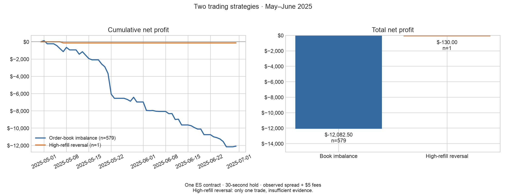

# Two simple trading strategies

Only four project files:

| File | Purpose |
|---|---|
| `backtest.py` | Both strategies, profit calculations, and graphs |
| `events.csv` | Prepared market data used by the backtest |
| `results.png` | Both profit graphs in one image |
| `README.md` | Instructions and results |

## Run

```sh
python -m pip install pandas matplotlib
python backtest.py
```

This prints the profit table and updates `results.png`. No API key or download is needed.

## Trading rules

Start after a 10-second price move exceeds the previous five sessions’ 99.5th
percentile. Observe the book for three seconds, then enter after 100 ms.

1. **Order-book imbalance:** buy when best-bid quantity exceeds best-ask quantity;
   sell when ask quantity is larger. Equal quantities mean no trade.
2. **High-refill reversal:** trade against the initial price move when the
   three-second refill ratio is at least 0.5. Otherwise, do not trade.

Each strategy trades one ES contract, holds for 30 seconds after actual entry,
and permits only one open position. Buy at the observed ask, sell at the bid,
and subtract $5 per round trip. Additional slippage is assumed to be zero.

## May–June 2025 results

| Strategy | Trades | Profit before fees, after spread | Fees | Net profit |
|---|---:|---:|---:|---:|
| Order-book imbalance | 579 | -$9,187.50 | $2,895.00 | **-$12,082.50** |
| High-refill reversal | 1 | -$125.00 | $5.00 | **-$130.00** |



**One high-refill trade is insufficient to judge that strategy.** The existing
refill definition measures quantity at the old pre-shock price; it is zero in
604 of 605 events because price rarely returns there within three seconds.

## Data

`events.csv` contains 605 prepared events from Databento ES.v.0 MBP-1 quotes,
covering 41 full regular sessions. Seven lack valid execution windows and are
skipped. Shock detection uses a 120-second cooldown. `book_imbalance` is
`(bid quantity - ask quantity) / (bid quantity + ask quantity)` at the end of
the three-second observation. `direction` is +1 for an upward shock, -1 for down.

This script reproduces trading results from prepared events, not from raw quotes.
The original data preparation, shock illustration, tests, and detailed analysis
are preserved in [the previous version](https://github.com/kevinyua12138/FINM-37000-FP/tree/0f95fc222aeceb2eae059e0e16135ef1f3881bbc).
The prepared data and trading rules are unchanged; every trade was checked
against that version. These are historical simulated results, and May–June
had already been examined before this two-strategy comparison was requested.
