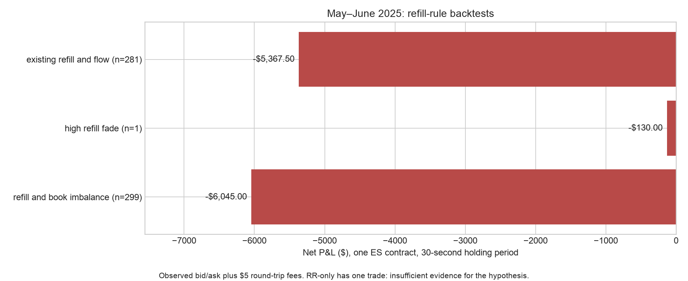

# Sweep or Snap Back? Order-Book Regimes and Short-Horizon Price Impact in E-mini S&P 500 Futures

FINM 37000 group project. Team: Kevin Yuan (Tech Leader), Yash Jain (Communications Leader), Simon Jung (Design Leader).

## Initial topic plan

**Question:** When the E-mini S&P 500 futures contract (ES, traded on CME Globex) makes a sudden large move, can the order book in the next few seconds tell us whether the move will continue or reverse?

**Idea:** An information-driven move leaves the eaten liquidity missing and order flow keeps pushing (continuation). A temporary liquidity squeeze refills quickly and order flow flips (reversal).

**Method:**
1. Detect 10-second shocks above the past-5-day 99.5th percentile (120-second cooldown).
2. Watch the book for 3 seconds and measure order-flow imbalance and liquidity replenishment.
3. Sort shocks into a 2×2 regime table (refill slow/fast × pressure strong/weak). When the two signals disagree, no trade.
4. Backtest at a 30-second horizon, crossing the spread.

**Hypotheses:**
- **H1:** strong same-direction order flow + slow refill → price continues over the next 30 seconds.
- **H2:** fast refill + reversing order flow → price reverses over the next 30 seconds.
- **H3:** a rule that follows H1 shocks and fades H2 shocks is profitable out-of-sample after paying the spread and fees.

**Data:** Databento GLBX.MDP3, ES front month (`ES.v.0`), mbp-1 for January–June 2025, regular hours only. mbp-10 depth data is a stretch goal.
- Settings (dataset, symbol, schema, session hours, cost cap) live in [`config.yaml`](../config.yaml).
- Download code: [`src/data/download.py`](../src/data/download.py). Raw files go to `data/raw/` and each download is logged in `data/raw/download_log.csv`.
- A first look at one day of data: [`notebooks/01_first_look.py`](../notebooks/01_first_look.py).
- Running the download needs a Databento API key (`DATABENTO_API_KEY`) and installing `requirements.txt`. Usage: `python src/data/download.py 2025-03-03` (add `--dry-run` to only print the cost).

The original proposal is preserved above. The reproducible implementation now fixes thresholds, feature formulas, execution timing, and sample splits in [the research specification](research_spec.md). These conventions are explicit for team review.

## Meeting notes

Weekly notes are in [`MeetingNotes/`](../MeetingNotes/).

## Contact and communication

| Member | Email | GitHub |
|---|---|---|
| Kevin Yuan | kevinyua@uchicago.edu | [kevinyua12138](https://github.com/kevinyua12138) |
| Simon Jung | simonjung@uchicago.edu | [simonfromseoul](https://github.com/simonfromseoul) |
| Yash Jain | yashjain@uchicago.edu | [yashjain12](https://github.com/yashjain12) |

Note: Simon and Yash have been made collaborators on this GitHub repository, so we push branches straight into Kevin's repository instead of working from forks. Changes still go through pull requests that Kevin merges.

## Roll and calendar flags (issue #4)

Generate 2025 ES roll, holiday, early-close, CPI, NFP, and FOMC day flags:

```sh
python3 main.py
python3 -m unittest discover -s tests -v
```

This offline command writes `data/processed/calendar_2025.csv`; it requires no
API key or third-party packages. Use `--start` and `--end` to select a date range.
See [calendar documentation](calendar.md) for joining flags onto downloaded
data, source references, holiday semantics, and supplying actual `ES.v.0` roll
dates. CME scheduled rolls and Databento volume-based transitions are separate.

## Imbalance and microprice features (issue #7)

`from features import book_features` (with `src` on the Python path) computes
`I_1`, `I_N`, microprice, gap `G`, and depth slope `DS` from decoded Databento
snapshot columns. Use `levels=1` for mbp-1 and `levels=10` for mbp-10; unavailable
depth features remain missing. See [formulas and usage](book_features.md).
Run `python3 -m unittest discover -s tests -v` to verify the features and calendar.


## Completed backtest: January–June 2025

The run processed **788,357,250 quote records across 122 full regular sessions**,
with 2,428 detected shocks and 2,424 usable feature windows. All 64 tests pass,
and an independent audit reconciles timestamps, historical thresholds, trade
P&L, fees, overlaps and reported metrics. The quoted full-period download cost
was $0; private raw files total 15.8 GB and are not committed.

**The existing refill proxy does not provide enough high-refill cases to test
that hypothesis:** RR is zero in 604 of 605 held-out events. Only one test event
has RR >= 0.5. The four high-refill training events all fall on April 4. The
fixed pre-shock price definition makes refill mechanically dependent on price
returning to that old level, so it is nearly always zero after a large shock.

May–June results, one contract, observed bid/ask and $2.50 fee per side:

| Rule | Trades | Net P&L | Interpretation |
|---|---:|---:|---|
| Original refill + flow | 281 | -$5,367.50 | Loss after costs; mean -$19.10/trade |
| High-refill reversal only | 1 | -$130.00 | Insufficient observations for inference |
| Refill + book imbalance | 299 | -$6,045.00 | Loss after costs |
| Logistic extension | 47 | -$4,197.50 | Test AUC 0.485 |

The original rule's mean net/trade 95% day-clustered interval is
[-$39.26, $1.05]. Its gross P&L already loses $3,962.50 after crossing the spread,
before fees. Adding one tick of slippage per side lowers net P&L to -$12,392.50.
A revised refill measure needs a new independent holdout; these results are not
used to pick or tune a replacement rule.




[Full findings and limitations](../results/full_2025/README.md) ·
[Validation audit](../results/full_2025/validation.json) ·
[Refill sample counts](../results/full_2025/refill_counts.csv)

## Reproducible project implementation

Use branch `codex/complete-backtest-results`. The implementation reuses the
existing calendar, snapshot features and labels, plus the team's
`issue-5-shock-detector` and `issue-9-replenishment` work. The new code uses plain
functions and processes one day at a time; there is no separate backtesting
framework or parameter-search system.

```sh
python -m pip install -r requirements.txt
python -m pytest -q
python download_project.py --dry-run
python download_project.py --budget 0
python run_backtest.py --output results/full_2025
```

Provide `DATABENTO_API_KEY` or the existing `~/.databento_api_key` file locally.
The project downloader checks the total cost of the entire interval before
fetching data. Its default budget is zero. Existing full files are reused;
partial files are retried. Raw quotes and Parquet caches are ignored by Git.

The main run requires all regular sessions from January through June 2025.
January–April develops the strategy; May–June evaluates the frozen rule. The
first five regular sessions are used only for rolling-threshold history.
Holidays and half-days are excluded under the existing calendar convention.

| Issues | Implementation |
|---|---|
| #2 | Existing downloader plus total-budget, parallel daily download wrapper |
| #3 | `src/data/clean.py`: quote validation, stale-data barriers, as-of grid, Parquet caches |
| #4 | Existing 2025 calendar, plus observed contract-transition flags |
| #5 | Team detector integrated, with contract/gap barriers and explicit tick-unit exports |
| #6 | Existing label helper corrected to measure horizons from actual entry quote |
| #7 | Existing snapshot imbalance and microprice features |
| #8–#9 | Trade/quote flow and team's refill proxy, tested on hand-calculated examples |
| #10–#11 | Four-regime event study, development paths, day-clustered inference and OLS |
| #12–#14 | Bid/ask executions, fees, trade lists, held-out test and sensitivity table |
| #15 | Training-only logistic fit, held-out AUC/calibration and model backtest |
| #16 | Optional tested mbp-10 functions; real depth evaluation requires depth data |
| #17 | Generated results report, figures, assumptions and limitations |
| #24 | Proposed owner/timeline/figure plan in `MeetingNotes/Meeting3.md` |

See [the complete results report](../results/full_2025/README.md),
[trade-level results](../results/full_2025/trades.csv),
[robustness comparisons](../results/full_2025/robustness.csv), and
[the frozen research specification](research_spec.md).

The refill measure is a best-quote proxy and partly measures price recovery.
It does not observe hidden liquidity. Quote-based fills with zero added
slippage are optimistic; the stress table includes one tick per side. Fees are
an explicit illustrative assumption, not a brokerage quote. The optional
mbp-10 market evaluation is not claimed complete without real depth data.


### Simple refill hypotheses

The results compare high-refill-only reversal, refill plus displayed book
imbalance, and the existing refill-plus-flow rule. High refill means RR >= 0.5;
the price-shock threshold remains the historical 99.5th percentile. See
`results/full_2025/simple_rules.csv` and `results/full_2025/simple_rules.png`.
The three seconds are the observation window; the primary holding period is
30 seconds after entry. To plot price shocks for a completed session, run
`python plot_shocks.py --date 2025-01-10`.
