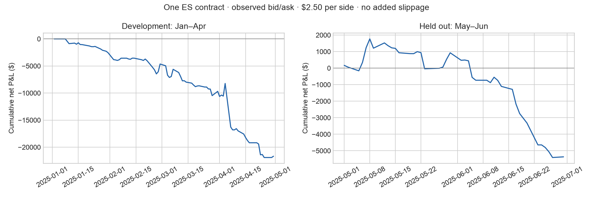
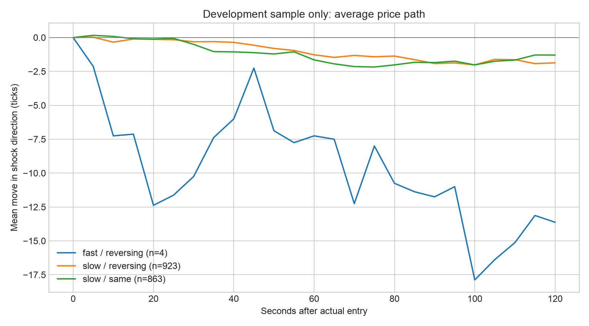
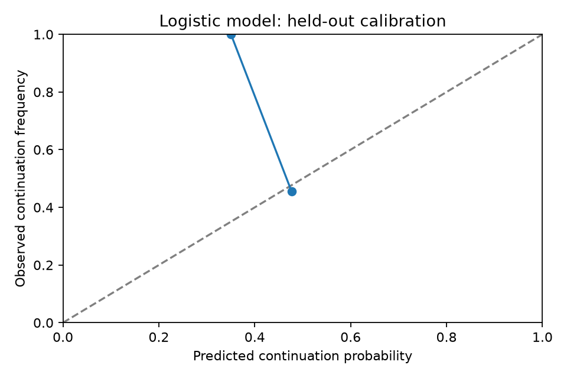
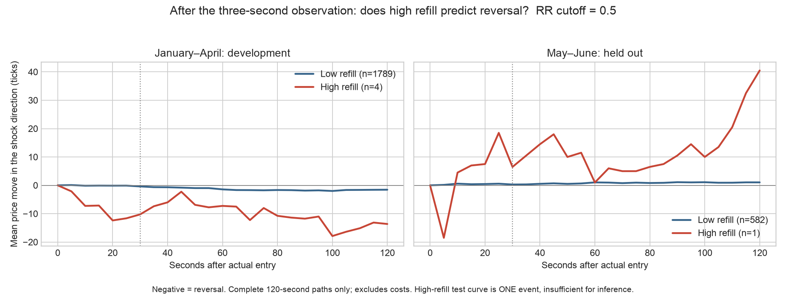

# Backtest results: ES shock continuation / reversal

**Key limitation for the refill hypothesis:** RR is zero in 604 of 605 held-out events. Only one held-out event has RR >= 0.5; its trade lost $130, which is not enough evidence to evaluate high-refill reversal. The development sample has only four high-refill events, all on April 4. The fixed-old-price proxy requires price to return to the pre-shock quote, making high refill extremely rare. The original strategy therefore behaves almost entirely like a slow-refill/order-flow rule. See `refill_counts.csv`. A revised refill definition would require a new independent test sample.

The frozen rule produced **negative held-out net P&L of -$5,367.50** over 281 trades in May–June 2025.

These are historical simulated executions, not live fills. One ES contract; buy at observed ask, sell at observed bid; illustrative $2.50 fee per side; zero additional slippage in the base case. See the slippage stress test.

| Period | Trades | Gross P&L after spread | Net P&L | Mean net/trade | Win rate | Max drawdown |
|---|---:|---:|---:|---:|---:|---:|
| train | 874 | -$17,300.00 | -$21,670.00 | -$24.79 | 44.3% | $22,145.00 |
| test | 281 | -$3,962.50 | -$5,367.50 | -$19.10 | 40.2% | $7,175.00 |

Held-out mean net/trade 95% day-clustered interval: [-$39.26, $1.05], t = -1.92, p = 0.06. There are 39 trading-day clusters with trades.

Held-out break-even round-trip fee after the observed spread: -$14.10 per contract. A negative figure means gross performance already loses after spread.

## Data and exclusions

122 full regular sessions, 2025-01-02 to 2025-06-30; 788,357,250 input records after regular-hours filtering. 45 invalid rows were retained as barriers. 2,428 detected shocks; 2,424 events with valid feature windows; 2,405 with valid 30-second labels.

The first five retained sessions are history only. Holidays/half-days are excluded. Coverage and event counts are saved per day. Further exclusions arise from missing features/quotes, insufficient displayed execution size, no-trade regimes and overlapping positions.

## Event study and model

The average paths below use development events with complete 120-second paths. Positive means price continues in the shock direction. Counts and day-clustered uncertainty at each horizon are in `regime_table.csv`. The regression is development-only.

Logistic model status: evaluated.
Held-out AUC: 0.48; Brier score: 0.25; net P&L: -$4,197.50 across 47 trades. The scaler and coefficients use January–April only. AUC measures discrimination, not profitability.

## Your simple rules: held-out comparison

All rules use 99.5th-percentile 10-second shocks, observe the book for three seconds, enter after 100 ms, and hold for 30 seconds. High refill means RR >= 0.5. The comparison tests high refill alone and in combination with book imbalance or order flow.

| Rule | Trades | Net P&L | Mean net/trade | 95% clustered interval |
|---|---:|---:|---:|---|
| existing_refill_and_flow | 281 | -$5,367.50 | -$19.10 | [-$39.26, $1.05] |
| high_refill_fade | 1 | -$130.00 | -$130.00 | Not estimable (one trading day) |
| refill_and_book_imbalance | 299 | -$6,045.00 | -$20.22 | [-$39.48, -$0.95] |

See `simple_rules.csv` and `simple_rule_trades.csv`. These parallel hypotheses were specified before the held-out evaluation; the best realized result is not a newly validated strategy.

## Interpretation and limitations

- Refill is the team’s mbp-1 proxy, partly a price-recovery measure; hidden depth is unobserved.
- Zero added slippage and displayed quote fills can be optimistic. The robustness table includes one tick per side, slower entry, different fees and always-follow/fade baselines.
- Filtering stale/invalid windows can select more liquid observations; counts are disclosed.
- Six months and one instrument do not establish a durable trading edge or causal mechanism. Clustered uncertainty and sensitivity results must accompany the headline P&L.
- The test data were used for this frozen evaluation. Any strategy chosen from its sensitivity results requires a new holdout.
- Real mbp-10 evaluation remains optional and unrun: depth data had a nonzero quoted price. No depth measurements or market performance have been fabricated.

## Files and reproduction

`events.csv`, `trades.csv`, `metrics.csv`, `daily_pnl.csv`, `coverage.csv`, `regime_table.csv`, `regression.csv`, `robustness.csv`, `model_predictions.csv`, `model_trades.csv`, `model_metrics.json`, `model_calibration.csv`, `frozen_model.json`, `frozen_config.json` and `provenance.json`.

From the repository root: `python run_backtest.py --output results/full_2025`. This requires the private raw data; quotes are not committed. See `../../docs/research_spec.md` for setup, formulas, sources and assumptions.

## Shock and refill figures

The 99.5th-percentile threshold that day was 16 ticks (4 points) over ten seconds, calculated from the previous five sessions. Nineteen events passed the threshold and cooldown.

The high-refill test curve is a single event, not evidence of an average relationship.
