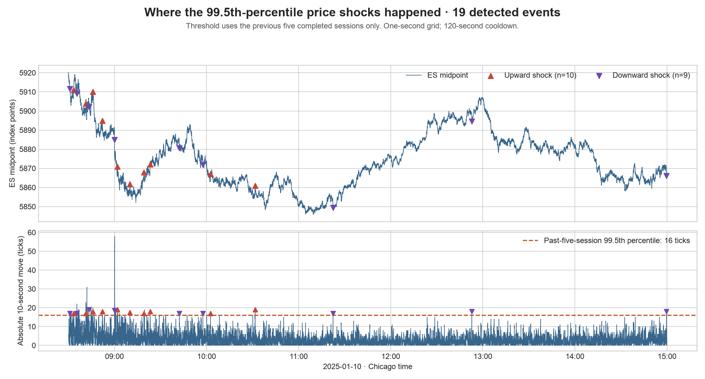

# Two trading strategies: profit and graphs

Both strategies start after a large ES price movement: the absolute 10-second
midpoint change exceeds the previous five sessions’ 99.5th percentile.
Signals are checked once per second with a 120-second cooldown.
Observe the next **3 seconds**, enter after another **100 milliseconds**, and
exit **30 seconds after the actual entry**.

1. **Order-book imbalance:** buy if displayed quantity at the best bid exceeds
   quantity at the best ask; sell if ask quantity is larger. Equal quantities
   mean no trade. This uses quantity, not the number of orders.
2. **High-refill reversal:** if the refill ratio is at least **0.5**, trade
   against the initial shock: sell after an upward shock, buy after a downward
   shock. Otherwise, do not trade.

Each strategy trades one ES contract, with at most one position open. Buys
execute at the observed ask and sells at the observed bid. Fees are $5 per
round trip. No additional slippage is assumed.

## Results: May–June 2025

| Strategy | Trades | Profit after spread, before fees | Fees | Net profit | Win rate |
|---|---:|---:|---:|---:|---:|
| Order-book imbalance | 579 | -$9,187.50 | $2,895.00 | **-$12,082.50** | 40.76% |
| High-refill reversal | 1 | -$125.00 | $5.00 | **-$130.00** | 0.00% |

The imbalance strategy lost money. **One high-refill trade is too few to judge
the reversal strategy.** The team’s existing refill definition tracks displayed
quantity at the pre-shock quote price. It is zero in 604 of 605 test events,
because price rarely returns to that level within three seconds. The threshold
and refill definition were kept unchanged.


## Example: where the price shocks happen

January 10 is an illustration from the development period, separate from the
May–June profit calculation. The threshold was 16 ticks (4 points); triangles
mark the 19 qualifying shocks.



## Run it

```sh
cd simple_backtest
python -m pip install -r requirements.txt
python backtest.py
```

The script reads `events.csv` and writes `results.csv`, `trades.csv`,
`profit_curve.png`, and `profit_comparison.png`. The shock illustration is
already included. Trading rules and profit calculations are in the `backtest`
function; the rest of the file saves results and graphs.

## Data and checks

The included file contains 605 May–June events from the previously prepared
Databento GLBX.MDP3 ES.v.0 MBP-1 data, including three-second features and actual
entry/exit quotes. Seven events lack valid 30-second execution windows;
equal-imbalance events are also skipped by the imbalance rule. The 41 full
regular sessions follow the original calendar.

Source: `results/full_2025/events.csv` in project commit `d977aa6`. Its `I_1` is
signed in the shock direction; `book_imbalance = I_1 * direction` restores the
ordinary `(bid quantity - ask quantity) / (bid quantity + ask quantity)` sign.
Prices and refill ratios are copied unchanged. The original data-preparation
code remains in the project for reproducing these events from raw quotes.

Trade counts and profit reconcile with the existing execution engine. Timing,
non-overlapping positions, fees, and hand-calculated long/short cases were checked.
This is a historical simulation. May–June was the original test period, but its
results had already been seen before this simplified comparison was requested;
this is not a new independent validation. No rule was tuned to improve profit.
